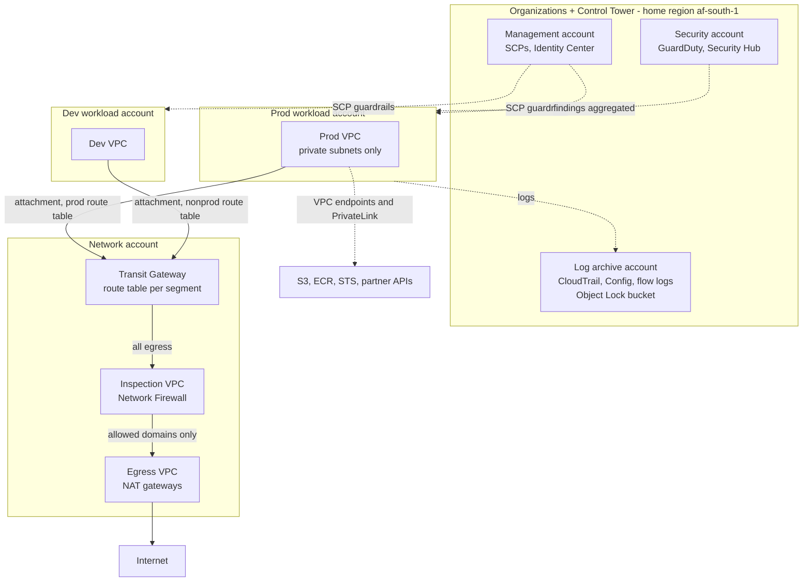
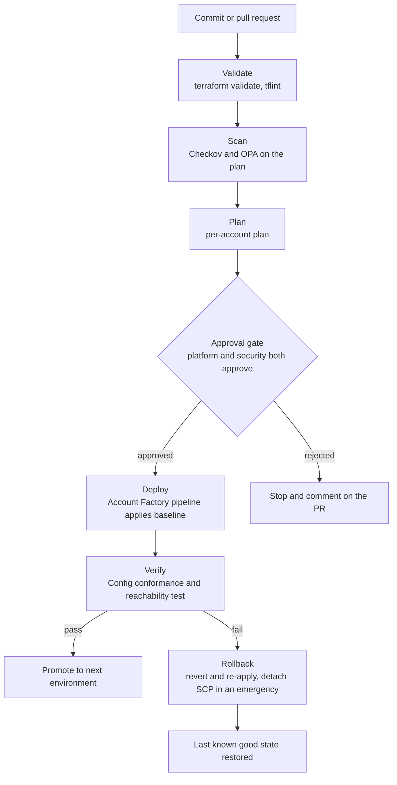
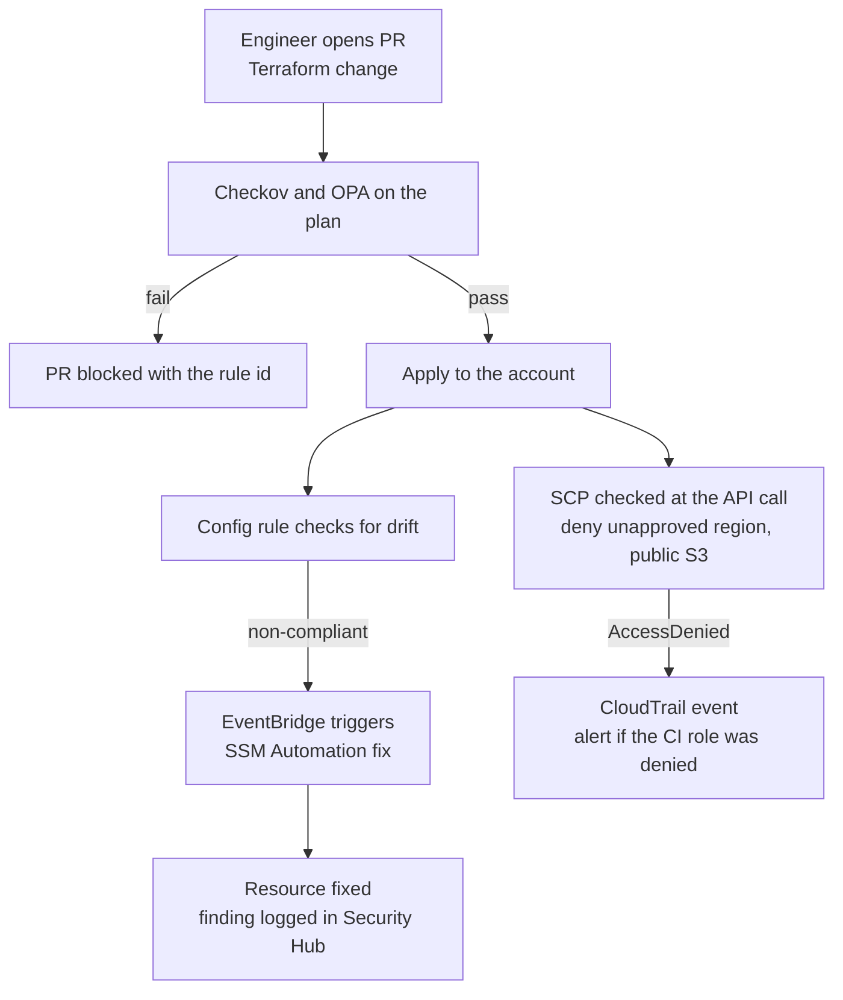

# Multi-Account Network Backbone

A Control Tower landing zone with a central Transit Gateway, an inspection VPC running Network Firewall, and Service Control Policies that make unsafe configurations impossible instead of discouraged.

### Business use case

A growing South African retailer, insurer or telco has ten AWS accounts, flat networking and shared admin keys. It needs segmentation between prod and dev, one controlled door to the internet, and an audit trail it can hand to a regulator.

### The hard piece

Zero-trust networking with policy-as-code and auto-remediation

### Rough monthly cost, ZAR

R600 to R1,800 a month if you apply for sessions and destroy. Always on, Network Firewall endpoints, Transit Gateway attachments and NAT gateways push it past R9,000, so treat the network account as a module you create for demos.

### Tool stack

- AWS Organizations
- Control Tower + Account Factory for Terraform
- IAM Identity Center
- Service Control Policies
- Transit Gateway
- Network Firewall (Suricata, domain allowlist)
- VPC endpoints + PrivateLink
- Route 53 Resolver
- Resource Access Manager
- GuardDuty + Security Hub
- Config conformance packs
- SSM Automation
- Terraform
- GitHub Actions + OIDC
- Checkov + OPA

### Diagrams

#### Diagram 1 · Architecture: accounts, Transit Gateway, inspection

> **How to read this:** Both workload VPCs attach to the Transit Gateway, but they use different route tables, so prod and dev cannot reach each other. Anything bound for the internet is forced through the inspection VPC, where the firewall allows only named domains. Dotted lines are control and audit: SCPs limit what the accounts may do, and logs flow to the log archive account.

#### Diagram 2 · CI/CD: account vending and network changes

> **How to read this:** Follow the top line from a commit to a deploy: the pipeline stops at the first red step, and nothing reaches the approval gate unless validation, scanning and the plan all passed. The bottom branch is the one hiring managers ask about: when verification fails, the rollback box puts the environment back without a human editing the console.

#### Diagram 3 · Hard piece: policy-as-code with auto-remediation

> **How to read this:** There are three layers and each catches something different. The PR check stops bad code before it exists, the SCP stops a bad API call even from an admin, and Config plus SSM repairs drift that happened outside the pipeline. Draw this in your README and explain why you need all three.

### How it covers the five focus areas

- **Compute** (light): A sample ECS Fargate service and a small EC2 Auto Scaling group in the prod account prove the network works. SCPs restrict regions and instance types.
- **Networking · HOME**: Transit Gateway with separate route tables per segment and blackhole routes, centralised inspection and egress, VPC endpoints with endpoint policies, Route 53 Resolver endpoints, RAM-shared subnets, no public subnets in prod.
- **Storage** (deep): Org-wide S3 Block Public Access by SCP, a log archive bucket with Object Lock and a locked KMS key policy, default EBS encryption, VPC-endpoint-only bucket policies.
- **CI/CD** (deep): Account Factory for Terraform vends accounts from a PR. Each account pipeline runs policy tests, plan, approval, apply with OIDC.
- **Cost optimisation** (light): Account-level budgets, tag policies, a cost comparison of centralised versus per-VPC NAT, and a note on Transit Gateway data processing charges.
### Advanced features that show depth

- Transit Gateway route table segmentation with blackhole routes between prod and dev
- Domain-allowlist egress filtering with Network Firewall and alert-on-deny
- A data perimeter built from SCPs, aws:PrincipalOrgID conditions and VPC endpoint policies
- Config rule to SSM Automation remediation with an audit trail in Security Hub
- Identity Center permission sets with attribute-based access and a break-glass role

### Production-like touches

- Prod, nonprod and shared segments with their own route tables
- Alerts on SCP denies, GuardDuty findings and firewall deny spikes
- Runbook: vend a new account and attach it to the network
- Post-incident write-up: an SCP blocked the CI role during a deploy
- Network diagram and IP address plan (CIDR allocation table) in the repo

### What this proves beyond what you run today

| What you run today | Senior-level version | What it proves |
| --- | --- | --- |
| One account per app, shared VPC | Account per workload on a Transit Gateway | Blast radius and billing separation are the point, not the plumbing. |
| Security groups only | SCPs plus Network Firewall plus endpoint policies | You stop thinking per instance and start thinking per organisation. |
| CloudFormation stack per app | Terraform with Account Factory | Vending infrastructure as a product is a platform skill. |
| IAM users and roles | Identity Center permission sets | Central identity and short-lived credentials everywhere. |

### Résumé pitch

- Built a multi-account AWS landing zone with Control Tower and Terraform, vending new accounts in \[N\] minutes from a reviewed pull request.
- Designed a Transit Gateway network with centralised Network Firewall egress, cutting internet-facing exposure to \[N\] allow-listed domains.
- Enforced guardrails with \[N\] SCPs and Config auto-remediation, preventing \[N\] non-compliant deployments in testing.

> *Replace every \[N\] with a number you measured. If you cannot measure it, remove the claim.*
